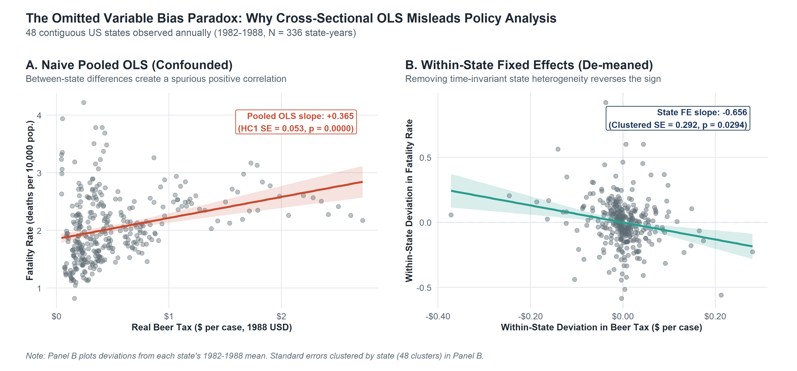
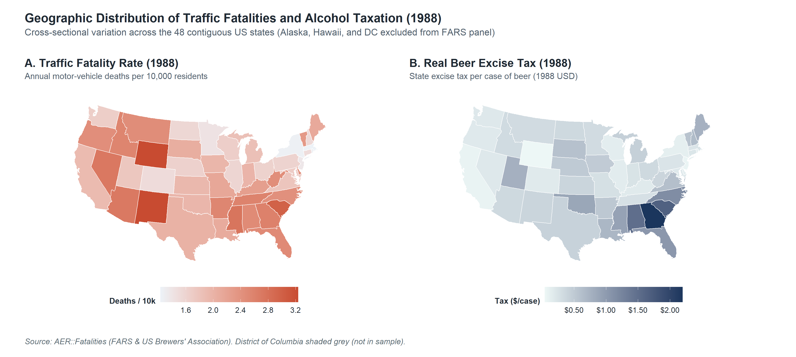
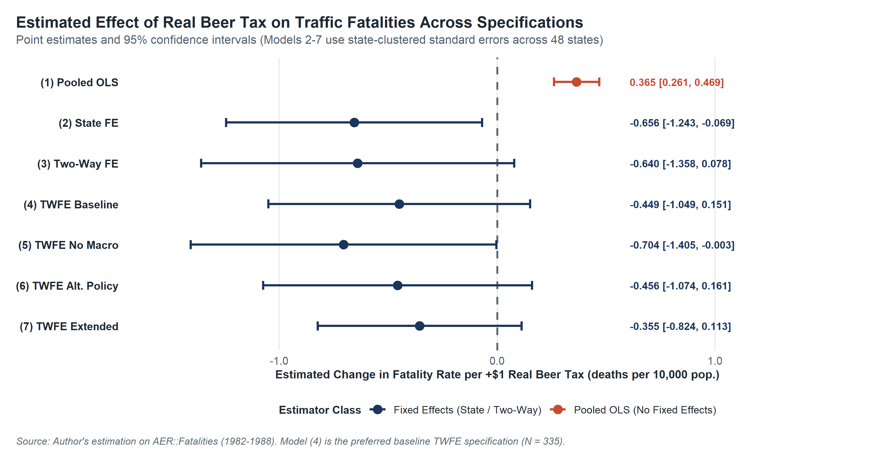
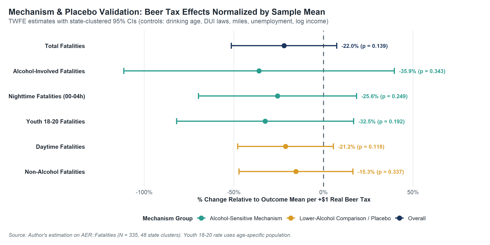
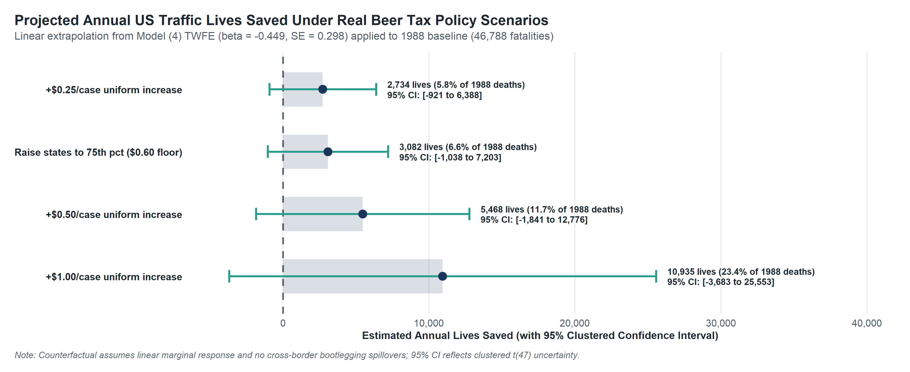

**English** | [Português (BR)](README.pt-BR.md)

# Alcohol Excise Taxes & US Traffic Fatalities: Causal Panel Analysis in R

[](https://www.r-project.org/)
[](https://quarto.org/)
[](#methodology--econometric-architecture)
[](LICENSE)

> **Interactive HTML Report:** View the full self-contained Quarto technical report in [`docs/index.html`](docs/index.html) (or publish directly via **GitHub Pages → Settings → Pages → Deploy from `main` / `/docs`**).

---

## Executive Summary

**Policy Question:** *Do higher state beer excise taxes reduce motor-vehicle fatalities, or does cross-sectional confounding reverse the apparent relationship?*

Using a 7-year state panel covering the **48 contiguous US states (1982–1988)** from `AER::Fatalities` ($N = 336$ state-years; $N = 335$ in controlled specifications due to California 1988 missingness in DUI sentencing variables), this project implements a reproducible causal-inference workflow in **R** (`fixest`, `plm`, `tidyverse`, `modelsummary`, `gt`, `Quarto`).

### Key Empirical Findings

| Dimension | Empirical Finding | Methodological Significance |
|---|---|---|
| **OVB Sign Reversal** | Pooled OLS yields **+0.365** ($p = 2.64 \times 10^{-11}$, $R^2 = 0.093$); adding State FE flips the slope to **-0.656** ($p = 0.029$, $R^2 = 0.905$) | Naive cross-sections suffer severe omitted variable bias from persistent cross-state heterogeneity |
| **Preferred TWFE Baseline (M4)** | **-0.449** deaths per 10,000 pop. per +\$1.00 real beer tax ($R^2 = 0.940$, Within $R^2 = 0.360$) | Equivalent to **-22.0%** of the sample mean (`2.04` deaths/10k) |
| **Inference & Clustering Lesson** | Naive IID ($\text{SE} = 0.170, p = 0.0086$) and HC1 ($\text{SE} = 0.222, p = 0.0444$) understate uncertainty; **48-state clustering widens SE to 0.298** ($p = 0.139$, 95% CI `[-1.049, +0.151]`) | Wooldridge AR(1) ($F = 10.54, p = 0.0013$) and BG ($\chi^2 = 27.52, p = 1.16 \times 10^{-4}$) confirm strong serial correlation |
| **Specification & Wald Tests** | Hausman FE vs. RE rejects RE ($p = 1.58 \times 10^{-12}$); State macro controls ($F = 30.35, p = 3.45 \times 10^{-9}$) & Year FEs ($F = 10.13, p = 3.57 \times 10^{-7}$) are strongly significant; MLDA ($p = 0.787$) & DUI laws ($p = 0.723$) are not | Resolves joint exclusion tests and demonstrates why controlling for unemployment and income matters |
| **Mechanism & Placebo Gradient** | Point estimates are larger for **alcohol-involved** (**-35.9%**) and **youth 18–20** (**-32.5%**) fatalities than **non-alcohol** (**-15.3%**) | Directional gradient matches theory, though wide clustered CIs cross zero across all subgroups |
| **Robustness & Jackknife** | Population-weighted TWFE (WLS): **-0.512** ($\text{SE} = 0.256, p = 0.0515$); all **48/48** Leave-One-State-Out iterations remain negative (`-0.662` [UT] to `-0.258` [SC]) | Effect is not driven by any single state, while 1-year adjacent FD (`+0.128`) loses signal vs. 6-year long FD (`-1.041`) |
| **Counterfactual Policy (1988)** | A uniform **+\$0.50/case** hike projects **~5,468 annual lives saved** (`11.7%` of 46,788 deaths), 95% CI `[-1,841, +12,776]` | Quantifies both economic magnitude and statistical uncertainty transparently |

---

## Visual Highlights

### 1. The Omitted Variable Bias Paradox
Cross-sectional OLS creates a spurious positive slope (+0.365) because high-tax Southern states also exhibit higher baseline fatality rates. Removing time-invariant state means immediately recovers a negative relationship (-0.656).



### 2. Geographic Distribution (1988 Cross-Section)
Spatial clustering across the 48 contiguous states highlights why regional baseline differences confound naive regressions.



### 3. Model Progression (Pooled OLS → Two-Way Fixed Effects)
Coefficient stability across seven nested econometric specifications, showing how adding state fixed effects, year shocks, and macroeconomic controls affects both magnitude and precision.



### 4. Mechanism & Placebo Validation
Relative to each outcome's sample mean, estimated reductions are largest in alcohol-involved and youth (18–20) mortality, though state-clustered confidence intervals span zero across subsamples.



### 5. Counterfactual Annual Lives Saved (1988 Baseline)
Projected lives saved across four real beer tax scenarios, propagating full clustered $t(47)$ uncertainty.



---

## Summary of Core Regression Results

| Specification | `beertax` Estimate | Clustered / Robust SE | p-value | State FE | Year FE | $R^2$ | Within $R^2$ | $N$ |
|---|---:|---:|---:|:---:|:---:|---:|---:|---:|
| **(1) Pooled OLS** | **+0.365** | 0.053 (HC1) | `<0.001` | No | No | 0.093 | — | 336 |
| **(2) State FE** | **-0.656** | 0.292 (Cluster) | 0.029 | Yes | No | 0.905 | 0.041 | 336 |
| **(3) Two-Way FE** | **-0.640** | 0.357 (Cluster) | 0.080 | Yes | Yes | 0.909 | 0.036 | 336 |
| **(4) TWFE Baseline (Preferred)** | **-0.449** | 0.298 (Cluster) | 0.139 | Yes | Yes | 0.940 | 0.360 | 335 |
| **(5) TWFE No Macro Controls** | **-0.704** | 0.348 (Cluster) | 0.049 | Yes | Yes | 0.912 | 0.069 | 335 |
| **(6) TWFE Alt. Policy Form** | **-0.456** | 0.307 (Cluster) | 0.143 | Yes | Yes | 0.939 | 0.357 | 335 |
| **(7) TWFE Extended Controls** | **-0.355** | 0.233 (Cluster) | 0.134 | Yes | Yes | 0.949 | 0.465 | 335 |

---

## Methodology & Econometric Architecture

```text
us-traffic-fatalities-panel/
├── R/
│   ├── theme_config.R           # Portfolio ggplot2 theme, colorblind-safe palette, 300 DPI export
│   ├── data_prep.R              # Panel engineering, CA 1988 missingness audit, summary stats
│   ├── models_core.R            # Cross-sections, long 1st-diff, 7-column TWFE progression (fixest)
│   ├── diagnostics.R            # Poolability, BP LM, Hausman, BG/Wooldridge, Pesaran CD, Wald & SE matrix
│   ├── extensions_robustness.R  # Alcohol/night/youth vs placebo outcomes, WLS/FD/Log, 48-state jackknife
│   └── counterfactual.R         # 1988 policy simulation & clustered t(47) confidence bounds
├── scripts/
│   ├── 01_prepare_data.R        # Generates processed RDS/CSV + audit/dictionary tables
│   ├── 02_eda_visualizations.R  # Produces Figures 01–03
│   ├── 03_panel_models.R        # Fits core models & produces Figure 04
│   ├── 04_diagnostics_robustness.R # Runs diagnostics/extensions & produces Figures 05–06
│   └── 05_counterfactual_policy.R  # Runs policy simulation & produces Figure 07
├── reports/
│   └── traffic_fatalities_panel.qmd # Full technical Quarto report source
├── docs/
│   ├── index.html               # Self-contained rendered HTML report (GitHub Pages ready)
│   └── .nojekyll
├── data/processed/              # Clean exported panel dataset (.rds / .csv)
├── outputs/
│   ├── figures/                 # High-resolution 300 DPI PNG visualizations
│   ├── models/                  # Fitted RDS model artifacts
│   └── tables/                  # Tidy CSV summaries for all models and diagnostics
├── run_all.R                    # Single entry-point pipeline + Quarto build orchestrator
├── us-traffic-fatalities-panel.Rproj
├── LICENSE                      # MIT License (2026 Matheus Brasil)
├── README.md                    # English documentation (primary)
└── README.pt-BR.md              # Portuguese executive documentation
```

---

## Quick Start & Reproducibility

### Prerequisites
- **R** (`>= 4.3`) and **Quarto CLI** (`>= 1.4`)
- Required CRAN packages: `AER`, `fixest`, `plm`, `dplyr`, `tidyr`, `ggplot2`, `readr`, `purrr`, `stringr`, `forcats`, `tibble`, `scales`, `patchwork`, `modelsummary`, `gt`, `broom`, `maps`, `mapproj`, `knitr`, `rmarkdown`, `sandwich`, `lmtest`

### Run the Entire Pipeline End-to-End

```r
# From the repository root:
Rscript run_all.R
```

Running `run_all.R` executes scripts `01` through `05` in order, refreshes all tables, models, and 300 DPI figures under `outputs/`, and renders `reports/traffic_fatalities_panel.qmd` directly into `docs/index.html`.

### One-Click GitHub Pages Hosting
Because `docs/index.html` is pre-rendered with `embed-resources: true` alongside `docs/.nojekyll`, you can publish the interactive technical report immediately on GitHub by enabling **Settings → Pages → Deploy from a branch (`main`, `/docs`)**.

---

## References & Project Origin

- Bertrand, M., Duflo, E., & Mullainathan, S. (2004). How Much Should We Trust Differences-in-Differences Estimates? *Quarterly Journal of Economics*, 119(1), 249–275.
- Kleiber, C., & Zeileis, A. (2008). *Applied Econometrics with R*. Springer-Verlag (`AER::Fatalities`).
- Ruhm, C. J. (1996). Alcohol Policies and Highway Vehicle Fatalities. *Journal of Health Economics*, 15(4), 435–454.
- Stock, J. H., & Watson, M. W. (2007). *Introduction to Econometrics* (2nd ed.). Addison Wesley.

*Origin Note:* Solo portfolio refactoring and methodological expansion by **Matheus Brasil**, originally inspired by an undergraduate Econometrics panel-data assignment at UFPR (2022).
