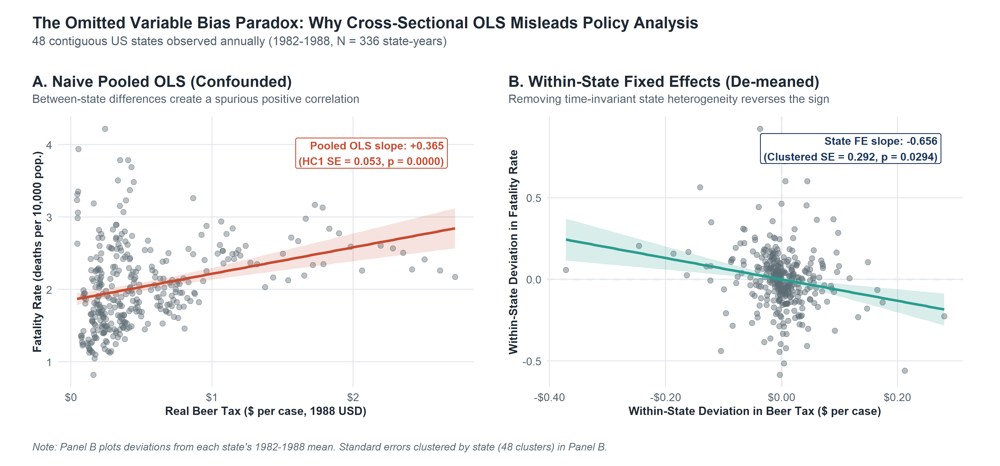
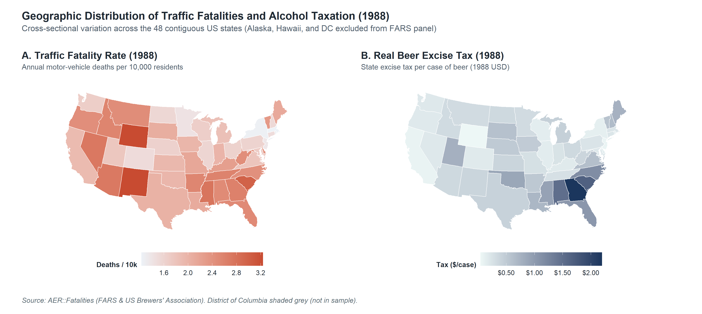
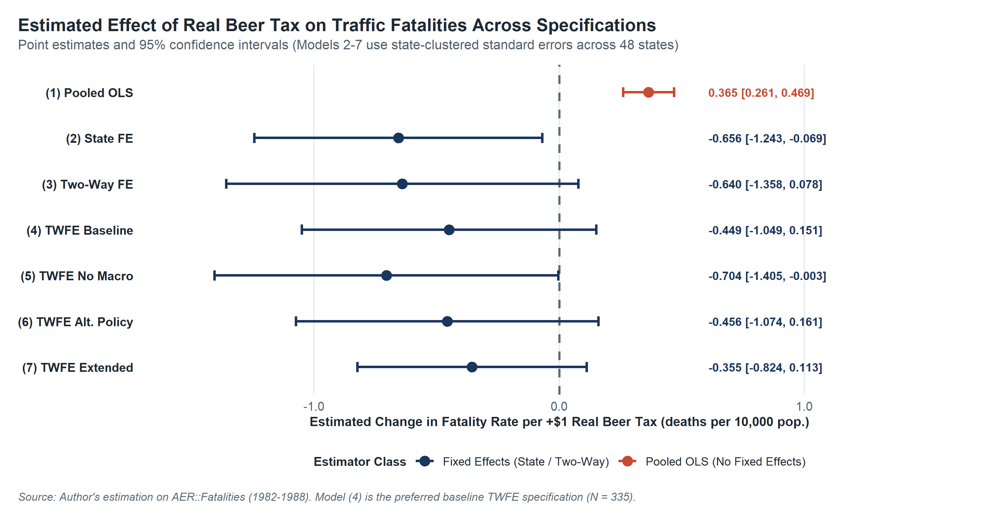
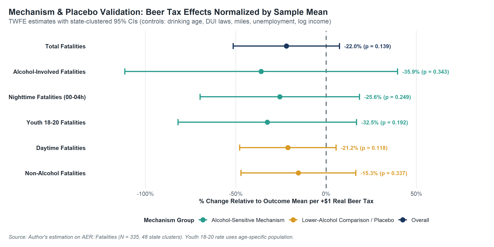
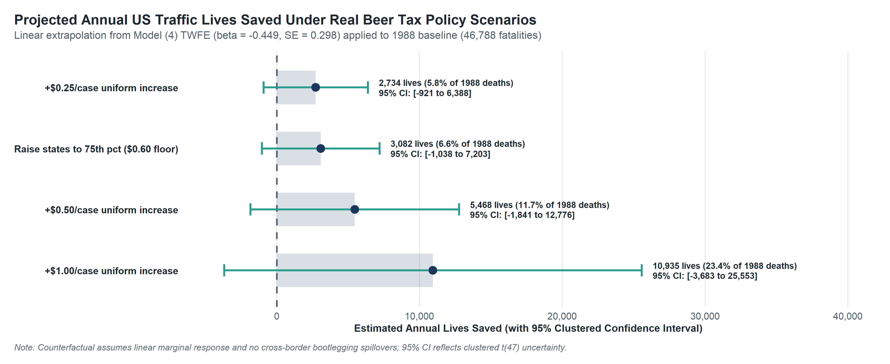

[English](README.md) | **Português (BR)**

# Impostos sobre Álcool e Fatalidades no Trânsito nos EUA: Análise Causal com Dados em Painel em R

[](https://www.r-project.org/)
[](https://quarto.org/)
[](README.md)
[](LICENSE)

> **Relatório Técnico Interativo (HTML):** Acesse o relatório completo em Quarto em [`docs/index.html`](docs/index.html) (pronto para publicação em 1 clique no **GitHub Pages** via `main` / `/docs`).

---

## Resumo Executivo

**Pergunta de Política Pública:** *Impostos estaduais mais altos sobre a cerveja reduzem fatalidades no trânsito ou a correlação transversal (cross-section) distorce a relação causal?*

Utilizando um painel estadual de 7 anos cobrindo os **48 estados contíguos dos EUA (1982–1988)** da base `AER::Fatalities` ($N = 336$ estados-ano; $N = 335$ nas especificações com controles devido à ausência de `jail`/`service` na Califórnia em 1988), este projeto implementa uma pipeline modular e reprodutível de inferência causal em **R** (`fixest`, `plm`, `tidyverse`, `modelsummary`, `gt`, `Quarto`).

### Principais Achados Empíricos

| Dimensão | Resultado Empírico | Implicação Metodológica |
|---|---|---|
| **Inversão de Sinal (OVB)** | Pooled OLS gera **+0,365** ($p = 2,64 \times 10^{-11}$, $R^2 = 0,093$); ao incluir Efeitos Fixos Estaduais, o sinal inverte para **-0,656** ($p = 0,029$, $R^2 = 0,905$) | Regressões transversais sofrem severo viés de variáveis omitidas por heterogeneidade persistente entre estados |
| **Modelo Principal TWFE (M4)** | **-0,449** mortes por 10.000 hab. para cada +\$1,00 de imposto real na cerveja ($R^2 = 0,940$, Within $R^2 = 0,360$) | Equivale a **-22,0%** da média amostral (`2,04` mortes/10 mil hab.) |
| **Lição de Inferência e Clusterização** | Erros IID ($\text{EP} = 0,170, p = 0,0086$) e HC1 ($\text{EP} = 0,222, p = 0,0444$) subestimam a incerteza; **erros clusterizados nos 48 estados ampliam o EP para 0,298** ($p = 0,139$, IC 95% `[-1,049; +0,151]`) | Testes de Wooldridge AR(1) ($F = 10,54, p = 0,0013$) e BG ($\chi^2 = 27,52, p = 1,16 \times 10^{-4}$) confirmam forte autocorrelação serial |
| **Diagnósticos e Testes de Wald** | Hausman FE vs. RE rejeita RE ($p = 1,58 \times 10^{-12}$); controles macroeconômicos ($F = 30,35, p = 3,45 \times 10^{-9}$) e efeitos fixos de ano ($F = 10,13, p = 3,57 \times 10^{-7}$) são altamente significativos; idade mínima ($p = 0,787$) e punições DUI ($p = 0,723$) não | Preenche os testes conjuntos de restrição e mostra o peso do ciclo econômico (desemprego e renda) |
| **Mecanismo e Placebos** | Reduções percentuais mais intensas em fatalidades **ligadas ao álcool** (**-35,9%**) e **jovens de 18–20 anos** (**-32,5%**) do que em mortes **sem álcool** (**-15,3%**) | Gradiente direcional consistente com a teoria, embora todos os ICs clusterizados cruzem zero |
| **Robustez e Jackknife** | TWFE ponderado por população (WLS): **-0,512** ($\text{EP} = 0,256, p = 0,0515$); todas as **48/48** iterações Leave-One-State-Out permanecem negativas (`-0,662` [UT] a `-0,258` [SC]) | O sinal negativo não depende de nenhum estado isolado; 1ª diferença anual (`+0,128`) perde sinal diante da diferença longa de 6 anos (`-1,041`) |
| **Simulação Contrafactual (1988)** | Um aumento uniforme de **+\$0,50/caixa** projeta **~5.468 vidas salvas/ano** (`11,7%` de 46.788 óbitos), com IC 95% `[-1.841; +12.776]` | Comunica magnitude econômica e incerteza estatística com total transparência |

---

## Destaques Visuais

### 1. O Paradoxo do Viés de Variáveis Omitidas (OVB)
O Pooled OLS produz inclinação positiva espúria (+0,365) porque diferenças estruturais entre estados confundem a relação; ao remover as médias intraestaduais, emerge a inclinação negativa prevista pela teoria (-0,656).



### 2. Distribuição Geográfica (1988)
Padrões regionais nos 48 estados contíguos ilustram por que fatores culturais, viários e econômicos precisam ser controlados via efeitos fixos.



### 3. Progressão dos Modelos (Pooled OLS → Two-Way Fixed Effects)
Comparação dos coeficientes estimados e intervalos de confiança de 95% ao longo das 7 especificações econométricas.



### 4. Validação de Mecanismo e Placebos
Comparação percentual relativa à média amostral entre mortes envolvendo álcool, noturnas e jovens (18–20 anos) versus mortes diurnas e sem álcool.



### 5. Impacto Contrafactual em 1988
Estimativa de vidas salvas anualmente em quatro cenários de política tributária com intervalos de confiança de 95% baseados em erros clusterizados ($t_{47}$).



---

## Resumo dos Principais Modelos

| Especificação | Coef. `beertax` | EP Robusto / Clusterizado | p-valor | EF Estado | EF Ano | $R^2$ | Within $R^2$ | $N$ |
|---|---:|---:|---:|:---:|:---:|---:|---:|---:|
| **(1) Pooled OLS** | **+0,365** | 0,053 (HC1) | `<0,001` | Não | Não | 0,093 | — | 336 |
| **(2) Efeitos Fixos (Estado)** | **-0,656** | 0,292 (Cluster) | 0,029 | Sim | Não | 0,905 | 0,041 | 336 |
| **(3) Two-Way FE (TWFE)** | **-0,640** | 0,357 (Cluster) | 0,080 | Sim | Sim | 0,909 | 0,036 | 336 |
| **(4) TWFE Base (Preferido)** | **-0,449** | 0,298 (Cluster) | 0,139 | Sim | Sim | 0,940 | 0,360 | 335 |
| **(5) TWFE Sem Controles Macro** | **-0,704** | 0,348 (Cluster) | 0,049 | Sim | Sim | 0,912 | 0,069 | 335 |
| **(6) TWFE Forma Alt. Leis** | **-0,456** | 0,307 (Cluster) | 0,143 | Sim | Sim | 0,939 | 0,357 | 335 |
| **(7) TWFE Controles Estendidos** | **-0,355** | 0,233 (Cluster) | 0,134 | Sim | Sim | 0,949 | 0,465 | 335 |

---

## Como Reproduzir Localmente

1. Instale **R** (`>= 4.3`), **Quarto CLI** (`>= 1.4`) e os pacotes CRAN listados em `run_all.R`.
2. Execute toda a pipeline (preparação dos dados, 7 gráficos em 300 DPI, modelos, diagnósticos, simulações e renderização do relatório HTML para `docs/index.html`) com um único comando:

```r
Rscript run_all.R
```

3. Para publicar no **GitHub Pages**, ative **Settings → Pages → Deploy from a branch (`main`, `/docs`)**.

---

## Referências e Origem do Projeto

- Bertrand, M., Duflo, E., & Mullainathan, S. (2004). How Much Should We Trust Differences-in-Differences Estimates? *Quarterly Journal of Economics*, 119(1), 249–275.
- Kleiber, C., & Zeileis, A. (2008). *Applied Econometrics with R*. Springer-Verlag (`AER::Fatalities`).
- Ruhm, C. J. (1996). Alcohol Policies and Highway Vehicle Fatalities. *Journal of Health Economics*, 15(4), 435–454.
- Stock, J. H., & Watson, M. W. (2007). *Introduction to Econometrics* (2nd ed.). Addison Wesley.

*Nota de Origem:* Refatoração individual de portfólio e expansão metodológica conduzida por **Matheus Brasil**, originalmente inspirada em trabalho acadêmico da disciplina de Econometria na UFPR (2022).
