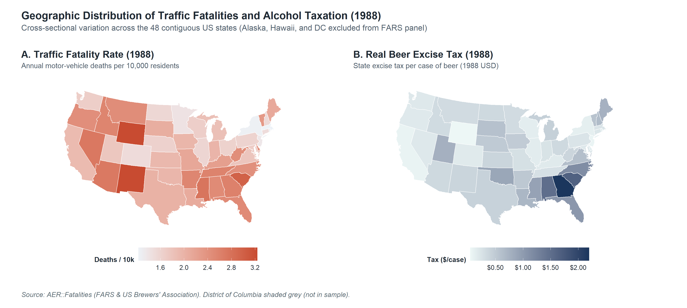
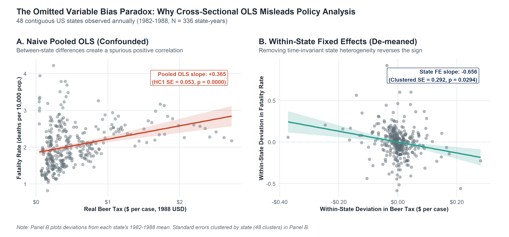
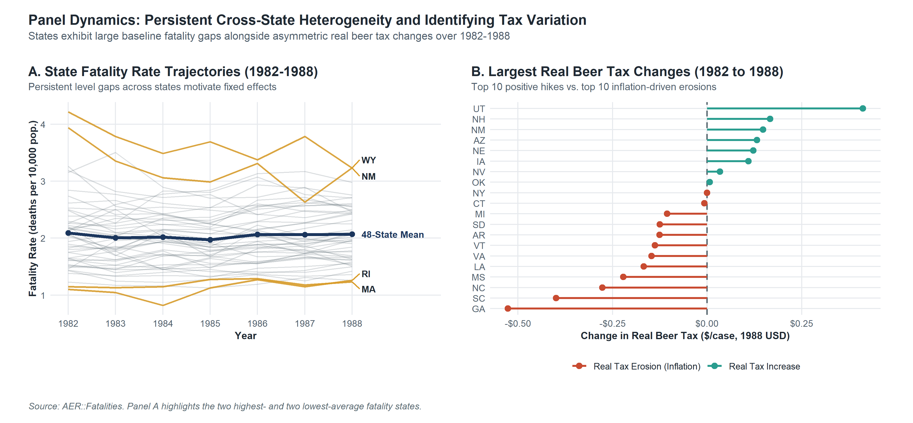
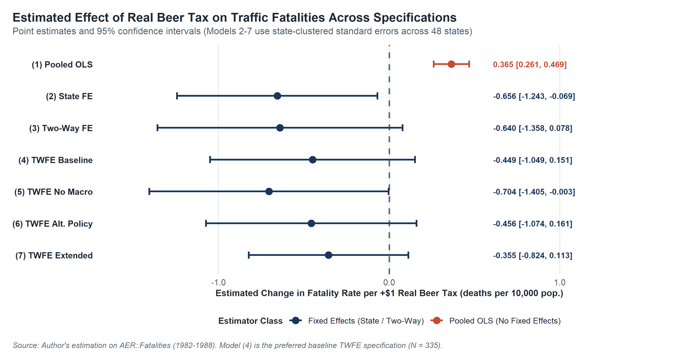
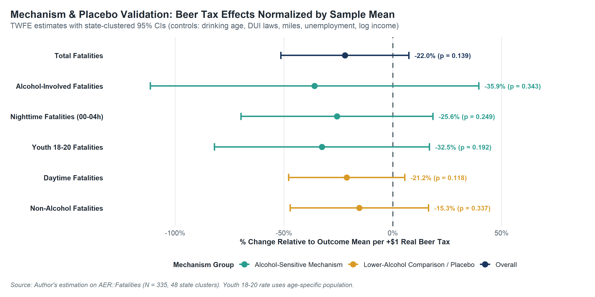
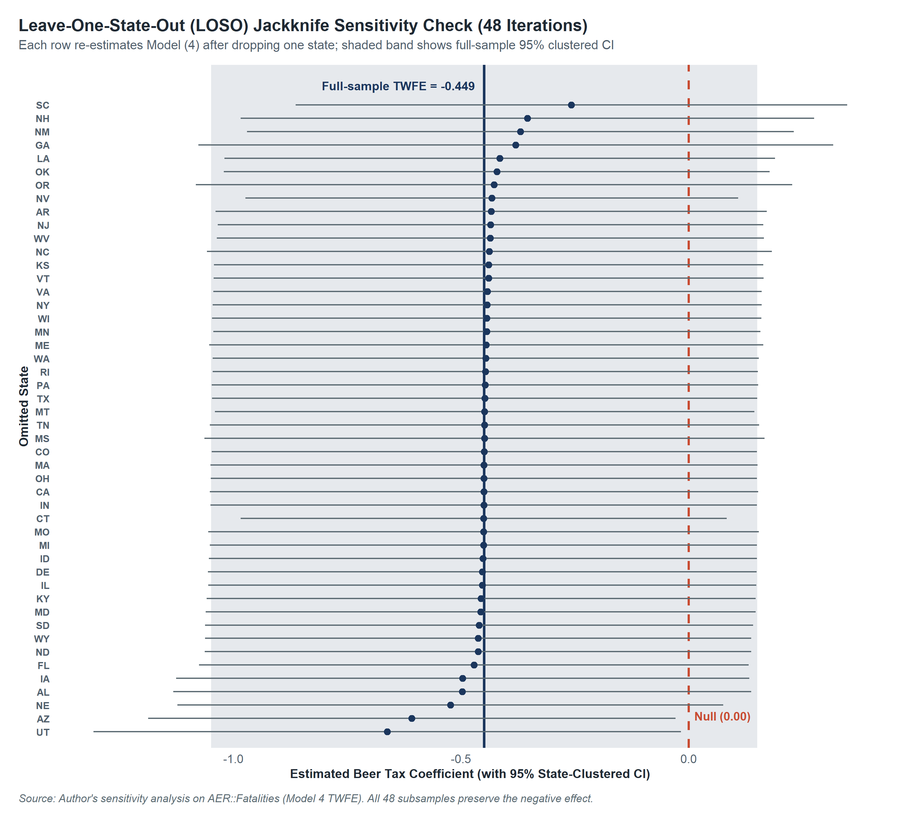
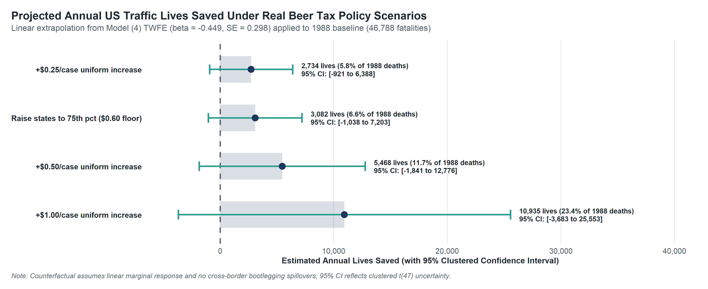

```{=html}
<style>
  body {
    font-size: 1.02rem;
    line-height: 1.65;
    color: #1F2933;
  }
  h1, h2, h3 {
    color: #1B365D;
    font-weight: 700;
  }
  .quarto-title-block .title {
    color: #1B365D;
  }
  .callout {
    border-radius: 6px;
    margin-top: 1.2rem;
    margin-bottom: 1.4rem;
  }
  .gt_table {
    margin-top: 1rem !important;
    margin-bottom: 1.5rem !important;
    font-size: 0.92rem !important;
  }
  figcaption {
    color: #52606D;
    font-style: italic;
    margin-top: 0.4rem;
  }
</style>
```

```{r setup}
#| include: false

user_lib <- Sys.getenv("R_LIBS_USER")
if (nzchar(user_lib) && dir.exists(user_lib)) {
  .libPaths(c(user_lib, .libPaths()))
}

library(dplyr)
library(readr)
library(tidyr)
library(gt)
library(modelsummary)
library(scales)
library(fixest)
library(knitr)

panel_df  <- readRDS("../data/processed/fatalities_panel.rds")
core_res  <- readRDS("../outputs/models/core_models.rds")
diag_res  <- readRDS("../outputs/models/diagnostics_robustness.rds")
cf_res    <- readRDS("../outputs/models/counterfactual.rds")

audit_tbl     <- read_csv("../outputs/tables/data_audit.csv", show_col_types = FALSE)
summary_tbl   <- read_csv("../outputs/tables/summary_stats.csv", show_col_types = FALSE)
dict_tbl      <- read_csv("../outputs/tables/data_dictionary.csv", show_col_types = FALSE)
prelim_tbl    <- read_csv("../outputs/tables/preliminary_models_summary.csv", show_col_types = FALSE)
main_tbl      <- read_csv("../outputs/tables/main_models_summary.csv", show_col_types = FALSE)
panel_diag    <- read_csv("../outputs/tables/panel_diagnostics.csv", show_col_types = FALSE)
wald_tbl      <- read_csv("../outputs/tables/wald_tests.csv", show_col_types = FALSE)
se_comp_tbl   <- read_csv("../outputs/tables/se_comparison.csv", show_col_types = FALSE)
subgroup_tbl  <- read_csv("../outputs/tables/subgroup_outcomes.csv", show_col_types = FALSE)
rob_tbl       <- read_csv("../outputs/tables/robustness_specs.csv", show_col_types = FALSE)
loso_tbl      <- read_csv("../outputs/tables/loso_sensitivity.csv", show_col_types = FALSE)
cf_tbl        <- read_csv("../outputs/tables/counterfactual_scenarios.csv", show_col_types = FALSE)
```

::: {.callout-important title="Executive Summary & Headline Empirical Findings"}
Do higher state alcohol excise taxes reduce traffic deaths, or does cross-sectional correlation mislead policy evaluation? Using a 7-year state panel covering the 48 contiguous US states (1982–1988, $N = 336$ state-years; $N = 335$ in controlled specifications due to California 1988 missingness in DUI sentencing indicators), this study demonstrates a textbook **Omitted Variable Bias (OVB) sign reversal** and highlights why **serial-correlation-robust inference** determines what policy conclusions can be claimed with statistical confidence:

1. **Cross-Sectional Bias Reversal**: Naive Pooled OLS suggests higher real beer taxes *increase* traffic fatalities ($\hat{\beta} = +0.365$, HC1 $\text{SE} = 0.053$, $p = 2.64 \times 10^{-11}$, $R^2 = 0.093$). Controlling for time-invariant state heterogeneity via State Fixed Effects flips the sign immediately ($\hat{\beta} = -0.656$, state-clustered $\text{SE} = 0.292$, $p = 0.029$, $R^2 = 0.905$).
2. **Preferred Two-Way Fixed Effects (TWFE) Baseline**: Adding year fixed effects, minimum legal drinking age dummies, mandatory DUI sentencing laws, driving exposure (`miles_k`), and state macroeconomic controls yields $\hat{\beta} = -0.449$ deaths per 10,000 residents per $+\$1.00$ real beer tax ($R^2 = 0.940$, Within $R^2 = 0.360$).
3. **Why Inference Matters (SE Sensitivity)**: Under naive IID ($\text{SE} = 0.170, p = 0.0086$), HC1 ($\text{SE} = 0.222, p = 0.0444$), or Driscoll-Kraay ($\text{SE} = 0.177, p = 0.0145$) standard errors, the baseline effect appears significant at 5%. However, formal Wooldridge AR(1) ($F = 10.54, p = 0.0013$) and Breusch-Godfrey ($\chi^2 = 27.52, p = 1.16 \times 10^{-4}$) tests confirm strong within-state serial correlation. Using **48-state clustered standard errors** widens the SE to $0.298$ ($p = 0.139$, 95% CI $[-1.049, +0.151]$), showing that limited within-state tax variation over 7 years leaves substantial statistical uncertainty once state macroeconomic cycles ($F = 30.35, p = 3.45 \times 10^{-9}$) are controlled.
4. **Mechanism, Robustness & Policy Extrapolation**: Point estimates are consistently negative across all 48 leave-one-state-out jackknife iterations (`-0.662` dropping Utah to `-0.258` dropping South Carolina), stronger under population-weighted WLS ($\hat{\beta} = -0.512, p = 0.0515$), and larger in relative terms for **alcohol-involved fatalities** ($-35.9\%$) and **youth 18–20 fatalities** ($-32.5\%$) than for **non-alcohol fatalities** ($-15.3\%$). A linear $+\$0.50$/case tax hike maps to roughly **5,468 annual lives saved** at the 1988 baseline (11.7% of 46,788 deaths), though its 95% clustered confidence interval ($[-1,841, +12,776]$) spans zero.
:::

---

# Research Question & Causal Identification Strategy

Evaluating the public-health impact of alcohol taxation using state-level observational data presents a classic causal inference challenge. States differ persistently in urban density, highway quality, commuting distances, vehicle fleet composition, and cultural attitudes toward drinking and driving. If states with higher traffic mortality or distinct regional drinking norms also enact different alcohol tax rates—or if nominal excise taxes are eroded unevenly by inflation—cross-sectional regressions confound policy effects with unobserved state characteristics.

To isolate within-state policy variation over time, we specify a **Two-Way Fixed Effects (TWFE)** panel regression model following Ruhm (1996) and Stock & Watson (2007):

$$
Y_{it} = \beta \cdot \text{BeerTax}_{it} + \mathbf{X}'_{it}\boldsymbol{\gamma} + \alpha_i + \lambda_t + \varepsilon_{it}
$$

where:

- $Y_{it}$ is the motor-vehicle fatality rate in state $i \in \{1,\dots,48\}$ and year $t \in \{1982,\dots,1988\}$ (measured per 10,000 residents, or age-specific population for youths aged 18–20);
- $\text{BeerTax}_{it}$ is the state real excise tax on a case of beer in constant 1988 US dollars;
- $\mathbf{X}_{it}$ is a vector of time-varying policy, exposure, and macroeconomic covariates (minimum legal drinking age, mandatory DUI jail/community service laws, average thousands of miles per driver, state unemployment rate, and log real per capita personal income);
- $\alpha_i$ absorbs all **time-invariant state heterogeneity** (geography, baseline road infrastructure, cultural norms);
- $\lambda_t$ absorbs **common national time shocks** (federal highway safety mandates, nationwide macroeconomic cycles, vehicle technology trends);
- $\varepsilon_{it}$ is the idiosyncratic error term, clustered at the state level across all 48 states to allow arbitrary within-state heteroskedasticity and serial correlation.

Identification of $\beta$ relies on the **parallel-trends / strict exogeneity assumption**: conditional on state fixed effects, year fixed effects, and time-varying state controls $\mathbf{X}_{it}$, changes in real beer taxes over 1982–1988 are uncorrelated with unobserved time-varying state shocks to traffic fatalities.

---

# Data Architecture, Quality Audit & Exploratory Analysis

The empirical dataset comes from `AER::Fatalities` (Kleiber & Zeileis, 2008), originally compiled by Ruhm (1996) from the US Department of Transportation **Fatal Accident Reporting System (FARS)**, the **US Brewers' Association**, the **Federal Highway Administration**, the **Bureau of Economic Analysis**, and the **Bureau of Labor Statistics**.

## Structural Balance & Missingness Audit

Before estimating any model, `R/data_prep.R` audits panel balance, missingness, and variable scaling. Importantly, the original raw `miles` column is recorded in raw miles per driver (mean `7,891`), so we rescale it to thousands of miles (`miles_k = miles / 1000`) for interpretable regression tables. Furthermore, although the raw 48-state × 7-year table has 336 rows, **California (1988)** has missing values (`NA`) for both `jail` and `service`, reducing the complete-case sample for controlled specifications (Models 4–7) from $N = 336$ to $N = 335$.

::: {.panel-tabset}

### Panel Balance & Audit

```{r audit-table}
audit_tbl |>
  gt() |>
  cols_label(metric = "Audit Dimension", value = "Observed Value") |>
  tab_header(
    title = md("**Table 1A. Panel Structure and Completeness Audit**"),
    subtitle = "AER::Fatalities (48 contiguous US states, 1982–1988)"
  ) |>
  tab_options(table.width = pct(100))
```

### Descriptive Statistics

```{r summary-stats-table}
summary_tbl |>
  select(-variable) |>
  gt() |>
  cols_label(
    label  = "Variable",
    n      = "N",
    mean   = "Mean",
    sd     = "SD",
    min    = "Min",
    p25    = "P25",
    median = "Median",
    p75    = "P75",
    max    = "Max"
  ) |>
  fmt_number(columns = c(mean, sd, min, p25, median, p75, max), decimals = 2) |>
  fmt_integer(columns = n) |>
  tab_header(
    title = md("**Table 1B. Summary Statistics Across State-Year Observations**"),
    subtitle = "All rates expressed per 10,000 residents (youth 18–20 uses age-specific population)"
  ) |>
  tab_options(table.width = pct(100))
```

### Variable Dictionary

```{r dictionary-table}
dict_tbl |>
  gt() |>
  cols_label(
    variable     = "Column",
    role         = "Analytical Role",
    unit_or_coding = "Unit / Coding",
    description  = "Definition & Source"
  ) |>
  tab_header(
    title = md("**Table 1C. Refactored Analytical Variable Dictionary**")
  ) |>
  tab_options(table.width = pct(100))
```

:::

## Geographic & Temporal Structure of the Data

Cross-sectional maps for 1988 reveal substantial geographic clustering: several Southern states (such as Georgia and South Carolina) exhibit relatively high real beer excise taxes alongside elevated traffic fatality rates, while several Northeastern states combine low fatality rates with modest beer taxes. Simultaneously, panel trajectories from 1982 to 1988 show persistent level gaps between high-fatality Western/Southern states (e.g., Wyoming and New Mexico) and low-fatality Northeastern states (e.g., Rhode Island and Massachusetts), while much of the within-state real beer tax variation arises from **inflation eroding fixed nominal tax rates** alongside isolated statutory hikes (most notably in Utah and New Hampshire).







---

# Core Panel Regression Progression

To demonstrate how omitted variable bias operates step by step, we replicate and refine the classic progression from Stock & Watson (2007): moving from single-year cross-sections and a 6-year long difference (`1988 − 1982`) to a full 7-column panel sequence culminating in controlled Two-Way Fixed Effects with state-clustered standard errors.

::: {.panel-tabset}

### Preliminary Cross-Sections & Long Difference

```{r prelim-models-table}
modelsummary(
  core_res$prelim$models |>
    setNames(c("1982 OLS", "1988 OLS", "Long Diff (1988 - 1982)")),
  coef_map = c(
    "beertax"     = "Real beer tax ($/case)",
    "d_beertax"   = "Change in real beer tax (1988 - 1982)",
    "(Intercept)" = "Intercept"
  ),
  stars = c("*" = 0.1, "**" = 0.05, "***" = 0.01),
  gof_map = c("nobs", "r.squared", "adj.r.squared"),
  output = "gt",
  title = "Table 2A. Cross-Sectional OLS Benchmarks vs. 6-Year Long First Difference"
) |>
  tab_source_note("HC1 heteroskedasticity-robust standard errors in parentheses.") |>
  tab_options(table.width = pct(90))
```

In both single-year cross-sections, `beertax` carries a positive coefficient (`+0.148`, `p = 0.269` in 1982; `+0.439`, `p = 0.0013` in 1988). Differencing 1988 minus 1982 across the same 48 states immediately eliminates time-invariant state confounders and yields $\hat{\beta} = -1.041$ ($\text{HC1 SE} = 0.355$, $p = 0.0052$, $R^2 = 0.119$).

### Main 7-Column Panel Progression

```{r main-models-table}
coef_labels <- c(
  "beertax"          = "Real beer tax ($/case)",
  "drinkagec18"      = "Min. drinking age: 18 (vs. 21+)",
  "drinkagec19"      = "Min. drinking age: 19 (vs. 21+)",
  "drinkagec20"      = "Min. drinking age: 20 (vs. 21+)",
  "drinkage"         = "Min. drinking age (continuous)",
  "jailyes"          = "Mandatory jail sentence",
  "serviceyes"       = "Mandatory community service",
  "punishyes"        = "Jail or community service",
  "miles_k"          = "Miles per driver (thousands)",
  "unemp"            = "State unemployment rate (%)",
  "log_income"       = "Log real per capita income",
  "breathyes"        = "Preliminary breath test law",
  "dry"              = "Dry county population (%)",
  "youngdrivers_pct" = "Drivers aged 15-24 (%)",
  "spirits"          = "Spirits consumption (gal/cap)",
  "(Intercept)"      = "Intercept"
)

add_rows <- tibble::tribble(
  ~term,             ~`(1) Pooled OLS`, ~`(2) State FE`, ~`(3) Two-Way FE`, ~`(4) TWFE Baseline`, ~`(5) TWFE No Macro`, ~`(6) TWFE Alt. Policy`, ~`(7) TWFE Extended`,
  "State FE",        "No",              "Yes",           "Yes",             "Yes",                "Yes",                "Yes",                   "Yes",
  "Year FE",         "No",              "No",            "Yes",             "Yes",                "Yes",                "Yes",                   "Yes",
  "Standard Errors", "HC1",             "State-Cluster", "State-Cluster",   "State-Cluster",      "State-Cluster",      "State-Cluster",         "State-Cluster"
)

modelsummary(
  core_res$main$models,
  coef_map = coef_labels,
  stars = c("*" = 0.1, "**" = 0.05, "***" = 0.01),
  gof_omit = "AIC|BIC|RMSE|Log|Std\\.Errors|FE:",
  add_rows = add_rows,
  output = "gt",
  title = "Table 2B. Panel Regression Progression: Pooled OLS to Controlled Two-Way Fixed Effects"
) |>
  tab_source_note("Dependent variable: total motor-vehicle fatality rate per 10,000 population. Standard errors clustered by state (48 clusters) in Columns (2)-(7).") |>
  tab_options(table.width = pct(100))
```

:::



### Key Analytical Takeaways from the Model Progression

- **Controlling for unobserved state traits explains almost 90% of fatality variance**: Moving from `(1) Pooled OLS` ($R^2 = 0.093$) to `(2) State FE` ($R^2 = 0.905$) flips $\hat{\beta}$ from $+0.365$ to $-0.656$ ($p = 0.029$).
- **Macroeconomic cycles strongly confound traffic exposure**: When state unemployment and log income are included in `(4) TWFE Baseline` (`N = 335`), within-$R^2$ jumps from `0.036` in `(3)` to `0.360` in `(4)`. Higher unemployment reduces driving and leisure travel (`unemp` $= -0.063$), while higher real income raises traffic exposure (`log_income` $= +1.81$). Omitting macro conditions in `(5) TWFE No Macro` overstates the tax coefficient (`-0.704`, $p = 0.049$) relative to `(4)` (`-0.449`, $p = 0.139$).
- **Formulation stability**: Switching between discrete drinking-age indicators and separate sentencing dummies in `(4)` (`-0.449`) versus continuous `drinkage` and combined `punish` in `(6)` (`-0.456`) leaves the tax estimate virtually unchanged. Adding `breath`, `dry`, `youngdrivers_pct`, and `spirits` in `(7) TWFE Extended` shrinks the estimate modestly to `-0.355` ($\text{SE} = 0.233, p = 0.134$).

---

# Specification Diagnostics & Robust Inference

A credible econometric pipeline must justify its estimator choice and covariance matrix rather than taking them on faith. Here we formally test poolability, random vs. fixed effects, residual serial correlation, cross-sectional dependence, and the joint exclusion restrictions left unimplemented in typical textbook scripts.

::: {.panel-tabset}

### Panel Specification Tests

```{r panel-diag-table}
panel_diag |>
  select(test, statistic_lbl, df, p_value, conclusion) |>
  gt() |>
  cols_label(
    test          = "Diagnostic Test",
    statistic_lbl = "Test Statistic",
    df            = "Degrees of Freedom",
    p_value       = "p-value",
    conclusion    = "Inference Decision"
  ) |>
  fmt_scientific(columns = p_value, rows = p_value < 0.001, decimals = 2) |>
  fmt_number(columns = p_value, rows = p_value >= 0.001, decimals = 4) |>
  tab_header(
    title = md("**Table 3A. Formal Panel Econometric Specification Tests**"),
    subtitle = "Poolability, Hausman FE vs. RE, Serial Correlation, and Cross-Sectional Dependence"
  ) |>
  tab_options(table.width = pct(100))
```

### Joint Wald Exclusion Tests

```{r wald-tests-table}
wald_tbl |>
  gt() |>
  cols_label(
    hypothesis_group = "Tested Variable Group (Model 4 TWFE)",
    df1              = "df1",
    df2              = "df2",
    f_stat           = "Wald F-stat",
    p_value          = "p-value",
    significant_5pct = "Significant (5%)?"
  ) |>
  fmt_number(columns = f_stat, decimals = 3) |>
  fmt_scientific(columns = p_value, rows = p_value < 0.001, decimals = 2) |>
  fmt_number(columns = p_value, rows = p_value >= 0.001, decimals = 4) |>
  tab_header(
    title = md("**Table 3B. Joint Hypothesis Wald F-Tests (State-Clustered VCOV)**"),
    subtitle = "Evaluated on Model (4) Baseline TWFE across 48 state clusters (df2 = 47)"
  ) |>
  tab_options(table.width = pct(100))
```

### Standard Error Estimator Comparison

```{r se-comp-table}
se_comp_tbl |>
  gt() |>
  cols_label(
    vcov_estimator = "Variance-Covariance Estimator",
    estimate       = "Estimate",
    std_error      = "Std. Error",
    df_t           = "t df",
    t_stat         = "t-stat",
    p_value        = "p-value",
    conf_low       = "95% CI Low",
    conf_high      = "95% CI High"
  ) |>
  fmt_number(columns = c(estimate, std_error, t_stat, conf_low, conf_high), decimals = 3) |>
  fmt_number(columns = p_value, decimals = 4) |>
  fmt_integer(columns = df_t) |>
  tab_header(
    title = md("**Table 3C. Sensitivity of Model (4) Beer Tax Inference to Covariance Estimator**"),
    subtitle = "Point estimate is fixed (-0.449); standard errors vary sharply across serial correlation assumptions"
  ) |>
  tab_options(table.width = pct(100))
```

:::

### Diagnosing Why State Clustering Changes the Conclusion

Table 3A and Table 3C explain a central methodological pitfall in applied panel studies—including the legacy coursework report that motivated this refactoring:

1. **Fixed Effects are non-negotiable**: Both the State Poolability $F$-test ($F = 44.54, p = 1.37 \times 10^{-102}$) and Time Fixed Effects $F$-test ($F = 19.57, p = 5.69 \times 10^{-19}$) overwhelmingly reject pooling. Both the classical Hausman test ($\chi^2 = 75.00, p = 1.58 \times 10^{-12}$) and the cluster-robust auxiliary Hausman test ($\chi^2 = 134.33, p = 1.52 \times 10^{-24}$) strictly reject Random Effects.
2. **Macroeconomic forces dominate legislative dummies**: Joint Wald tests confirm that state macroeconomic conditions ($F = 30.35, p = 3.45 \times 10^{-9}$) and common year shocks ($F = 10.13, p = 3.57 \times 10^{-7}$) jointly explain fatality movements, whereas discretized drinking-age dummies ($F = 0.353, p = 0.787$) and mandatory DUI punishment laws ($F = 0.326, p = 0.723$) lack joint precision within this 7-year window.
3. **Serial correlation invalidates IID and HC1 inference**: The Breusch-Godfrey/Wooldridge test ($\chi^2 = 27.52, p = 1.16 \times 10^{-4}$) and Wooldridge FE AR(1) test ($F = 10.54, p = 0.0013$) detect strong autocorrelation within states over time. Meanwhile, the Pesaran CD test ($z = -1.535, p = 0.125$) indicates that year fixed effects absorb most cross-state correlation. Consequently, non-clustered IID ($\text{SE} = 0.170, p = 0.0086$) and HC1 ($\text{SE} = 0.222, p = 0.0444$) standard errors understate uncertainty by **25% to 43%** relative to 48-state clustered standard errors ($\text{SE} = 0.298, p = 0.139$). Note also that Driscoll-Kraay ($\text{SE} = 0.177, p = 0.0145$) yields tighter SEs because its short-lag truncation (`L = 1` or `2` over $T = 7$) imposes more structure on within-state autocorrelation than unrestricted state clustering. Following Bertrand, Duflo & Mullainathan (2004), we retain **48-state clustered SEs** as the conservative, principled benchmark.

---

# Mechanism Validation, Alternative Estimators & Sensitivity

To probe whether the negative point estimate reflects an alcohol-specific mechanism rather than residual confounding or functional-form artifacts, we conduct three independent validation checks.

::: {.panel-tabset}

### Mechanism & Placebo Outcomes

If alcohol taxes deter drunk driving, relative fatality reductions should be concentrated in **alcohol-involved crashes**, **late-night crashes (00:00–03:59 AM)**, and **young drivers aged 18–20** rather than **non-alcohol** or **daytime** fatalities. Table 4A and Figure 5 test this hypothesis by scaling every TWFE coefficient as a percentage of the outcome's sample mean.

```{r subgroup-table}
subgroup_tbl |>
  select(outcome, category, mean_y, estimate, std_error, p_value, pct_effect) |>
  gt() |>
  cols_label(
    outcome    = "Outcome Rate",
    category   = "Mechanism Class",
    mean_y     = "Sample Mean",
    estimate   = "Beta",
    std_error  = "Clustered SE",
    p_value    = "p-value",
    pct_effect = "% of Mean"
  ) |>
  fmt_number(columns = c(mean_y, estimate, std_error, p_value), decimals = 3) |>
  fmt_number(columns = pct_effect, decimals = 1, pattern = "{x}%") |>
  tab_header(
    title = md("**Table 4A. Mechanism & Placebo Outcome Regressions (TWFE Baseline Controls)**"),
    subtitle = "All specifications include state & year FE, full controls, and 48-state clustered SEs (N = 335)"
  ) |>
  tab_options(table.width = pct(100))
```



Directionally, the normalized point estimates align with theory: a $+\$1.00$ real beer tax corresponds to **$-35.9\%$** for alcohol-involved fatalities and **$-32.5\%$** for youths aged 18–20, compared to **$-15.3\%$** for non-alcohol fatalities. However, because state-level alcohol fatality reporting and age-group rates carry higher noise, **every subgroup 95% confidence interval overlaps zero** (`p` ranging from `0.118` to `0.343`). Thus, the mechanism gradient is suggestive in magnitude but lacks standalone statistical precision in a 7-year state panel.

### Alternative Estimators (WLS, Log-Linear, FD)

```{r robustness-table}
rob_tbl |>
  gt() |>
  cols_label(
    specification = "Estimator / Functional Form",
    outcome_scale = "Dependent Variable Scale",
    estimate      = "Beta",
    std_error     = "Clustered SE",
    p_value       = "p-value",
    conf_low      = "95% CI Low",
    conf_high     = "95% CI High",
    n_obs         = "N"
  ) |>
  fmt_number(columns = c(estimate, std_error, p_value, conf_low, conf_high), decimals = 3) |>
  fmt_integer(columns = n_obs) |>
  tab_header(
    title = md("**Table 4B. Functional Form and Estimator Robustness Checks**"),
    subtitle = "Comparing Unweighted TWFE, Population-Weighted WLS, 1-Year First-Differences, and Log-Linear TWFE"
  ) |>
  tab_options(table.width = pct(100))
```

Two informative patterns emerge here:

1. **Population-Weighted TWFE (WLS)** increases precision and strengthens the point estimate ($\hat{\beta} = -0.512$, clustered $\text{SE} = 0.256, p = 0.0515$), indicating that larger states exhibit cleaner signal-to-noise ratios in annual fatality rates.
2. **Adjacent 1-Year First-Differences (`plm FD`)** attenuates toward zero ($\hat{\beta} = +0.128, p = 0.637$), in sharp contrast with the **6-year Long First-Difference** (`-1.041`, $p = 0.0052$) and TWFE (`-0.449`). In short annual panels where statutory beer taxes change infrequently and real rates drift gently via inflation, 1-year differencing removes most persistent policy signal while amplifying year-to-year noise and behavioral adjustment lags.

### 48-State Leave-One-State-Out Jackknife

```{r loso-summary-table}
loso_extremes <- bind_rows(
  loso_tbl |> slice_head(n = 3) |> mutate(group = "Most Negative (Dropping State Sharpens Effect)"),
  loso_tbl |> slice_tail(n = 3) |> mutate(group = "Least Negative (Dropping State Attenuates Effect)")
)

loso_extremes |>
  select(group, dropped_state, state_name, estimate, std_error, p_value, delta_from_full) |>
  gt(groupname_col = "group") |>
  cols_label(
    dropped_state   = "Code",
    state_name      = "Omitted State",
    estimate        = "Beta",
    std_error       = "Clustered SE",
    p_value         = "p-value",
    delta_from_full = "Delta vs. Full (-0.449)"
  ) |>
  fmt_number(columns = c(estimate, std_error, p_value, delta_from_full), decimals = 3) |>
  tab_header(
    title = md("**Table 4C. Most Influential States in 48-State Leave-One-State-Out Jackknife**")
  ) |>
  tab_options(table.width = pct(100))
```



Across all 48 subsamples, the `beertax` point estimate remains strictly negative (ranging from `-0.662` when dropping **Utah**, $p = 0.045$, and `-0.608` when dropping **Arizona**, $p = 0.040$, to `-0.258` when dropping **South Carolina**, $p = 0.397$). No single state creates the negative relationship, though South Carolina (which saw one of the largest real tax erosions alongside high baseline rates) contributes noticeable leverage.

:::

---

# Counterfactual Policy Simulation & Methodological Caveats

To translate the TWFE slope ($\hat{\beta} = -0.449, \text{SE} = 0.298$) into concrete public-health units, we evaluate four policy counterfactuals on the 1988 cross-section (48 states, **46,788 total traffic fatalities**): three uniform federal/coordinated real tax increases (`+$0.25`, `+$0.50`, `+$1.00` per case) and a state-level harmonization floor raising all states below the 1988 75th percentile (`$0.60/case`) up to that threshold (affecting 36 states). Uncertainty bounds propagate the exact state-clustered $t(47)$ 95% confidence interval (`[-1.049, +0.151]`).

```{r counterfactual-table}
cf_tbl |>
  arrange(lives_saved_est) |>
  select(
    scenario_label, states_affected, avg_tax_increase,
    lives_saved_est, lives_saved_low, lives_saved_high, pct_reduction_est
  ) |>
  gt() |>
  cols_label(
    scenario_label    = "Policy Scenario (1988 Baseline)",
    states_affected   = "States Affected",
    avg_tax_increase  = "Mean Tax Delta ($)",
    lives_saved_est   = "Est. Lives Saved",
    lives_saved_low   = "95% CI Low",
    lives_saved_high  = "95% CI High",
    pct_reduction_est = "% of 1988 Deaths"
  ) |>
  fmt_currency(columns = avg_tax_increase, decimals = 2) |>
  fmt_number(columns = c(lives_saved_est, lives_saved_low, lives_saved_high), decimals = 0) |>
  fmt_number(columns = pct_reduction_est, decimals = 1, pattern = "{x}%") |>
  tab_header(
    title = md("**Table 5. Projected Annual Traffic Lives Saved Under Counterfactual Beer Tax Policies**"),
    subtitle = "Applied to 1988 contiguous US traffic fatalities (46,788 deaths across 48 states)"
  ) |>
  tab_options(table.width = pct(100))
```



::: {.callout-warning title="Methodological Caveats & Scope Conditions"}
Any counterfactual extrapolation from observational panel estimates requires explicit caveats:

1. **Statistical uncertainty crosses zero**: Because the state-clustered 95% CI on Model (4) is `[-1.049, +0.151]`, every counterfactual confidence interval spans zero (e.g., `+$0.50/case` predicts `5,468` lives saved with 95% CI `[-1,841 to +12,776]`). Point estimates indicate meaningful potential savings, but cannot rule out null effects under conservative clustered inference.
2. **Linearity assumption for large tax shocks**: A `+$1.00/case` uniform increase represents roughly double the sample standard deviation of `beertax` (`0.478`), pushing extrapolation well outside typical within-state variation.
3. **Cross-border spillovers & substitution**: Unilateral state tax increases (such as the 75th-percentile floor) could induce cross-border alcohol purchases or beverage substitution toward wine/spirits not modeled in a single-tax equation.
4. **Historical external validity**: Data cover 1982–1988, a period preceding modern airbag adoption, widespread seat-belt enforcement, ridesharing, and lower legal BAC thresholds (0.08%). Absolute elasticities today may differ.
:::

---

# Conclusion, References & Session Reproducibility

This analysis illustrates why **panel causal identification** and **clustered standard errors** are twin pillars of applied econometrics. Without state fixed effects, cross-sectional OLS delivers a strongly significant but causally backwards positive coefficient (`+0.365`). Controlling for state heterogeneity, common time shocks, and macroeconomic cycles recovers a sizable negative point estimate (`-0.449` deaths per 10,000 residents; `-22.0%` of the sample mean), consistent across functional forms, population weights (`-0.512, p = 0.0515`), and all 48 leave-one-state-out subsamples. At the same time, formal serial-correlation diagnostics show why naive HC1 or IID standard errors severely overstate precision: once within-state autocorrelation is accounted for via 48-state clustering, substantial statistical uncertainty remains due to modest statutory tax variation in the 1982–1988 window.

## References

- Bertrand, M., Duflo, E., & Mullainathan, S. (2004). How Much Should We Trust Differences-in-Differences Estimates? *The Quarterly Journal of Economics*, 119(1), 249–275.
- Kleiber, C., & Zeileis, A. (2008). *Applied Econometrics with R*. Springer-Verlag, New York. (`AER::Fatalities` dataset).
- Ruhm, C. J. (1996). Alcohol Policies and Highway Vehicle Fatalities. *Journal of Health Economics*, 15(4), 435–454.
- Stock, J. H., & Watson, M. W. (2007). *Introduction to Econometrics* (2nd ed.). Addison Wesley, Boston.

*Project Origin Note*: This repository is a solo portfolio refactoring and methodological expansion by Matheus Brasil, originally inspired by an undergraduate Econometrics coursework assignment at UFPR (2022).

::: {.callout-note collapse="true" title="Computational Reproducibility & R Session Information"}
```{r session-info}
sessionInfo()
```
:::
